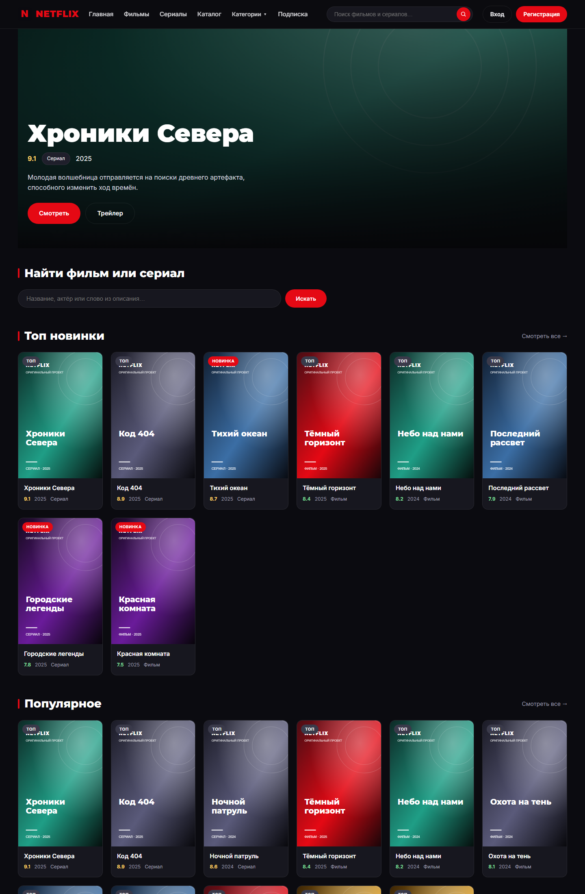
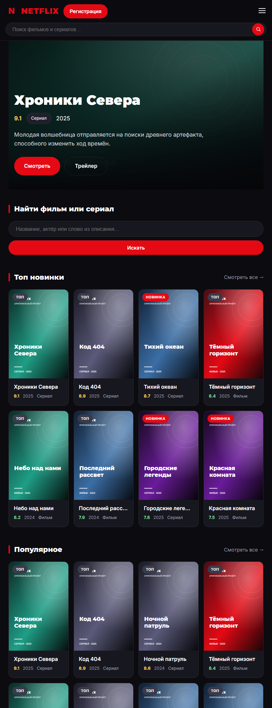
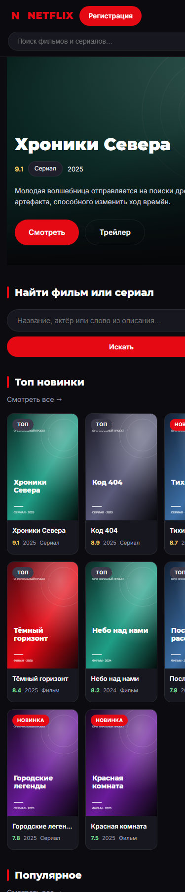
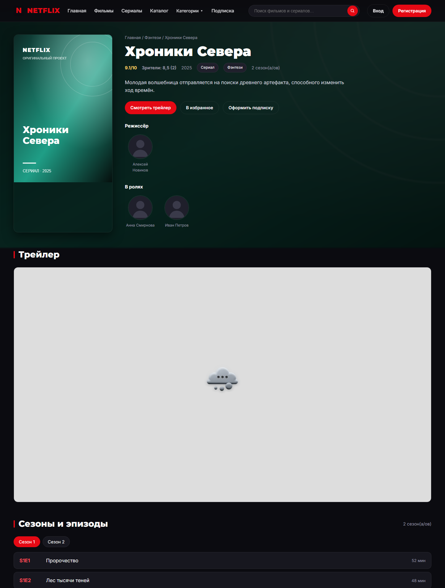
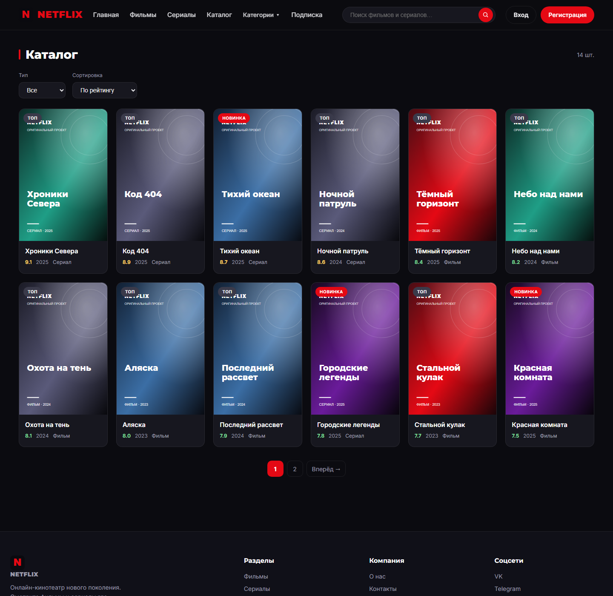
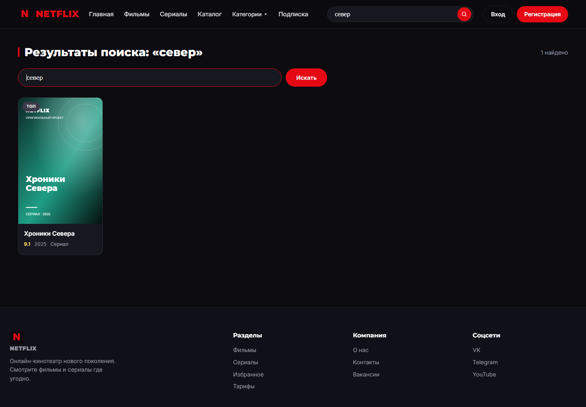
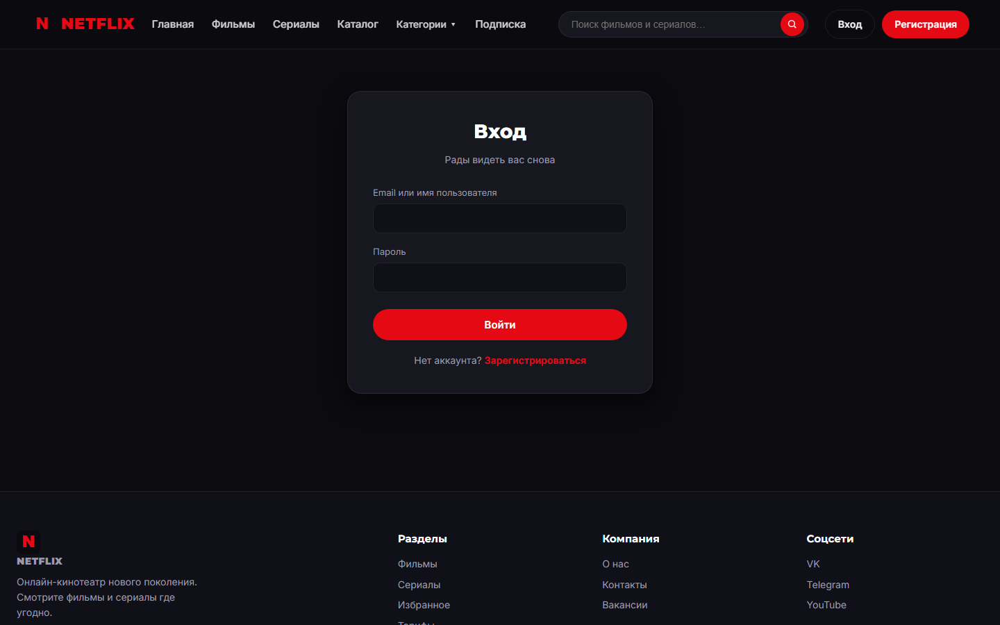
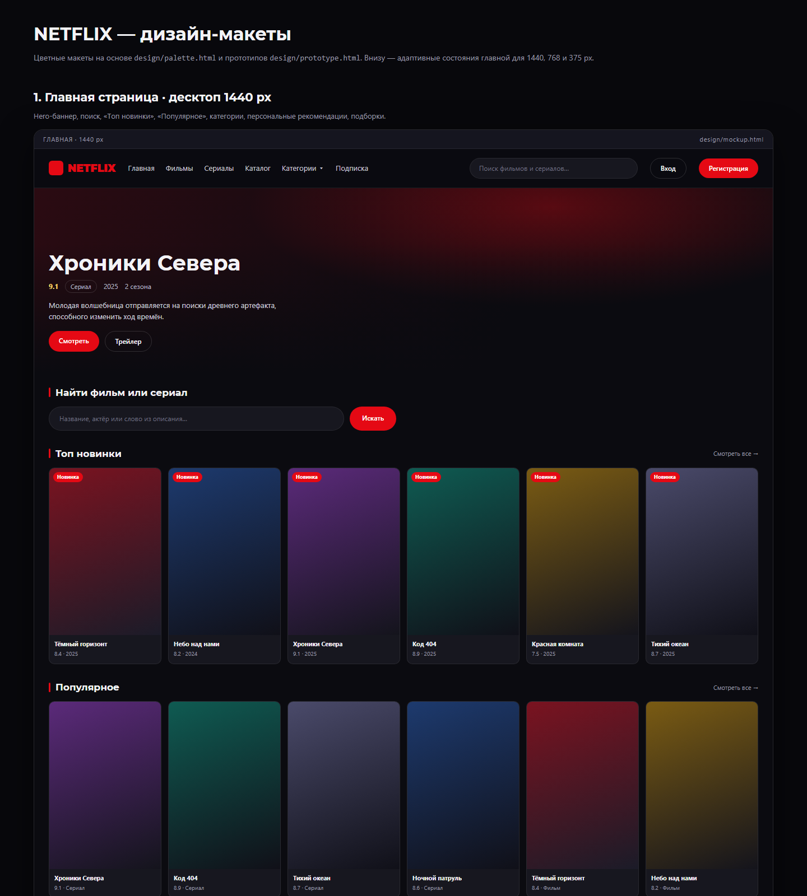

# NETFLIX — онлайн-кинотеатр

Учебный проект по **ПМ.01 «Проектирование и разработка информационных систем»**
(специальность 09.02.07, группа ИСП-311).

Сайт онлайн-кинотеатра: каталог фильмов и сериалов, категории и поиск, карточки
тайтлов с трейлерами и сезонами, регистрация и авторизация, личный кабинет
(история, избранное, подписка), тарифы с тестовой оплатой и админ-панель.

> **О названии.** По методичке проект делается для компании «Illuminos»;
> этот сайт выполнен под брендом **NETFLIX**. Расхождение зафиксировано в отчёте
> и не влияет на функциональность.

---

## Скриншоты

| Главная, 1440 px | Главная, 768 px |
|---|---|
|  |  |

| Главная, 375 px | Страница сериала |
|---|---|
|  |  |

| Каталог | Поиск |
|---|---|
|  |  |

| Вход и регистрация | Дизайн-макеты |
|---|---|
|  |  |

Дизайн-документы (открываются локально, без сервера):

- [`design/palette.html`](design/palette.html) — палитра с HEX-кодами и назначением цветов;
- [`design/prototype.html`](design/prototype.html) — прототипы главной и типовых страниц;
- [`design/mockup.html`](design/mockup.html) — дизайн-макеты и адаптив 1440 / 768 / 375 px.

---

## Стек

| Слой | Технологии |
|---|---|
| Разметка | HTML5, семантические теги, комментарии в коде |
| Стили | CSS3 (переменные, Grid, Flexbox), один внешний `assets/css/style.css` |
| Клиентская логика | нативный JavaScript (`assets/js/main.js`): меню, AJAX-регистрация, сезоны |
| Сервер | PHP 8.1, PDO, сессии, prepared statements |
| База данных | MySQL 5.7 (совместимо с 8.0 / MariaDB), utf8mb4, 11 таблиц |
| Сервер разработки | OpenServer Panel (Apache + PHP 8.1 + MySQL, порт 3308) |

Без сборки и пакетных менеджеров: проект запускается сразу после импорта БД.

---

## Быстрый старт

1. Запустить **OpenServer Panel**, включить Apache и MySQL.
2. Открыть phpMyAdmin → создать базу `cinema_db` (кодировка `utf8mb4_unicode_ci`).
3. Импортировать [`db.sql`](db.sql) — схема и тестовые данные (в дампе есть `CREATE TABLE`,
   данные и внешние ключи).
4. Скопировать проект в `C:\OSPanel\domains\localhost\NETFLIX`.
5. Открыть **http://localhost/NETFLIX/**.

Если MySQL слушает другой порт или база называется иначе — изменить константы
в `config/db.php` (`DB_HOST`, `DB_PORT`, `DB_NAME`, `DB_USER`, `DB_PASS`) или задать
переменные окружения с теми же именами.
По умолчанию: `127.0.0.1`, порт `3308`, база `cinema_db`, пользователь `root` без пароля.

Проверка синтаксиса PHP без запуска сайта:

```powershell
C:\OSPanel\modules\PHP\PHP_8.1\php.exe -l index.php
```

Запуск на встроенном сервере PHP (если Apache не нужен):

```powershell
C:\OSPanel\modules\PHP\PHP_8.1\php.exe -S 127.0.0.1:8099 -t C:\OSPanel\domains\localhost\NETFLIX
```

### Тестовые аккаунты

| Роль | Логин | Пароль | Что доступно |
|---|---|---|---|
| Администратор | `admin` | `admin123` | всё + админ-панель `/Admin/` |
| Подписчик | `anna_s` | `subscriber123` | кабинет, история, избранное, подписка |
| Пользователь | `dmitry_k` | `user123` | каталог, избранное, оформление подписки |

---

## Функциональность

### Главная страница (`index.php`)
- Hero-баннер самого популярного тайтла.
- «Топ новинки» и «Популярное» — из БД по флагам `is_new` / `is_popular`.
- Категории с количеством тайтлов → `catalog.php?category=slug`.
- Персональные рекомендации по жанрам избранного и истории; для гостя —
  популярное (честная подпись в блоке).
- Поиск: форма на главной и в шапке → `search.php?q=…` (название, описание,
  актёр или режиссёр; спецсимволы `%` и `_` экранируются).

### Каталог и списки
- `catalog.php` — фильтры «тип» и «сортировка», фильтр по категории, пагинация по 12.
- `movies.php` / `series.php` — отдельные списки, тоже понимают `?category=`.

### Страница фильма и сериала (`content.php?id=N`)
- Постер, описание, рейтинг, средняя оценка зрителей, категория, длительность.
- Режиссёры и актёры из БД.
- Трейлер (embed-ссылка из БД).
- Похожие тайтлы той же категории и типа.
- Для сериала — сезоны и эпизоды с переключением.
- Отзывы и оценка 1–10 (только после входа, с CSRF-защитой).
- Просмотр пишется в историю (одна запись на пару пользователь–тайтл).

### Личный кабинет (`profile.php`)
- Доступ только после входа (`require_login()`).
- Роль, статус подписки, дата окончания.
- Избранное (добавление/удаление), история просмотров, платежи.
- Регистрация (`register.php`) с серверной и клиентской валидацией,
  ошибки показываются без перезагрузки (fetch/AJAX).
- Вход (`login.php`) с `password_verify()` и `session_regenerate_id(true)`.
- Выход — POST с CSRF-токеном (`logout.php`).

### Оплата (`payment.php` → `gateway.php` → `payment-success.php`)
- Тарифы хранятся в таблице `plans` (цена, срок, список возможностей в JSON).
- Выбор тарифа создаёт платёж `pending` и переводит на тестовый шлюз.
- `gateway.php` — **эмулятор ЮKassa (песочница)**: карта `4111 1111 1111 1111`,
  срок `12/30`, CVC `123`. Реальные ключи не используются, деньги не списываются.
- После подтверждения: платёж `paid`, роль `subscriber`, подписка продлена на срок тарифа.
- Чек с номером платежа и датой окончания подписки.

### Админ-панель (`Admin/`)
- Доступ только роли `admin`: гость → вход, подписчик → 403.
- Сводка: тайтлы, пользователи, оплаченные подписки, сумма.
- CRUD контента: создание, редактирование, удаление (POST + CSRF), серверная валидация.
- Список пользователей с ролями и платежей со статусами.

---

## Структура проекта

```
NETFLIX/
├── Admin/                 админ-панель (index.php, edit.php)
├── assets/
│   ├── css/style.css      единственный внешний CSS с комментариями
│   ├── js/main.js         меню, валидация, AJAX-регистрация, сезоны
│   └── img/               постеры (SVG), фоны, заглушка аватара, favicon
├── config/
│   ├── config.php         старт сессии + подключение db.php + functions.php
│   ├── db.php             PDO-подключение и понятная ошибка при сбое
│   └── functions.php      e(), роли, CSRF, карточки, тарифы
├── design/                палитра, прототипы, макеты (HTML)
├── docs/screenshots/      скриншоты для README
├── includes/              header.php, footer.php, error-403.php, error-404.php
├── db.sql                 схема + тестовые данные (utf8mb4)
├── index.php              главная
├── catalog.php            каталог с фильтрами
├── movies.php, series.php списки по типу
├── content.php            страница фильма/сериала
├── search.php             поиск
├── favorites.php          избранное
├── toggle_favorite.php    добавление/удаление из избранного (POST)
├── login.php, register.php, logout.php
├── profile.php            личный кабинет
├── payment.php            тарифы
├── gateway.php            тестовый платёжный шлюз
├── payment-success.php    чек
└── README.md
```

---

## База данных

11 таблиц (InnoDB, utf8mb4, внешние ключи с `ON DELETE CASCADE`):

| Таблица | Назначение |
|---|---|
| `categories` | категории (драмы, комедии, ужасы, боевики, фэнтези, триллеры) |
| `content` | фильмы и сериалы: описание, постер, фон, трейлер, год, рейтинг, тип |
| `people` | актёры и режиссёры |
| `content_people` | связь «тайтл ↔ человек» |
| `episodes` | сезоны и эпизоды сериалов |
| `users` | пользователи: хеш пароля, роль, срок подписки |
| `favorites` | избранное |
| `history` | история просмотров (уникальная пара пользователь–тайтл) |
| `reviews` | отзывы и оценки 1–10 |
| `plans` | тарифы: цена, срок, возможности |
| `payments` | платежи: статус `pending` / `paid` / `canceled`, номер, дата оплаты |

Схему можно посмотреть в `db.sql` или в phpMyAdmin.

---

## Безопасность

- Пароли — `password_hash()` / `password_verify()`, в БД только хеш.
- Все запросы к БД — подготовленные (`PDO`, `ATTR_EMULATE_PREPARES => false`).
- Вывод — через `e()` (`htmlspecialchars`), защита от XSS.
- CSRF-токен на всех POST-формах: вход, регистрация, отзыв, избранное,
  оплата, удаление в админке, выход.
- Проверка роли на каждой защищённой странице; гость → вход, не-админ → 403.
- `session_regenerate_id(true)` после входа и регистрации; cookie `HttpOnly`, `SameSite=Lax`.
- Удаление контента — только POST, а не GET-ссылка.
- Понятные 403/404 и пустые состояния вместо «белого экрана».

---

## Публикация на GitHub

Локальный репозиторий инициализирован, история коммитов есть. Удалённый репозиторий
**не создан**: доступа к аккаунту GitHub у исполнителя нет, поэтому публикация
не имитируется. Точные команды — в [`docs/GITHUB.md`](docs/GITHUB.md).

---

## Ограничения

- Платёжная система не подключена по-настоящему: используется тестовый шлюз
  `gateway.php` (см. комментарии в коде и плашку «Тестовый режим» на странице оплаты).
- Бренд сайта — NETFLIX, хотя по методичке компания называется Illuminos.
- Демо-постеры и фоны — сгенерированные SVG-заглушки, а не официальные материалы фильмов.
